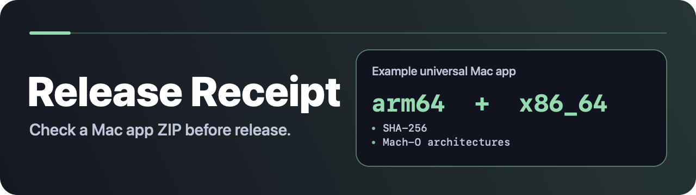
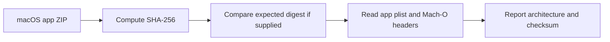

<p align="center">
  
</p>

# Release Receipt

Check a Mac app ZIP before publishing or installing it. Release Receipt computes its SHA-256, can compare it with a trusted value, and reads each bundled app executable’s Mach-O architecture table directly from the archive.

## At a glance

| Task | How |
| --- | --- |
| **Inspect a release ZIP** | Read its SHA-256 and the architectures of bundled app executables. |
| **Verify a known hash** | Use `--expected` for one hash or `--checksums` for a checksum file. |
| **Require a universal app** | Use `--require-universal` to check for Apple silicon and Intel support. |
| **Download** | [Get receipt.py](https://github.com/muddgrrrl/Release-Receipt/releases/latest/download/receipt.py) |

## Run

Use Python 3.11 or later. Clone or download the repository and run:

```sh
python3 receipt.py MyApp-macOS.zip
python3 receipt.py MyApp-macOS.zip --checksums SHA256SUMS.txt --require-universal
python3 receipt.py MyApp-macOS.zip --expected YOUR_64_DIGIT_SHA256 --json
```

A checksum mismatch exits with status **2** before inspecting the ZIP. A missing architecture under `--require-universal` exits with **3**. Unreadable or unsupported inputs exit with **1**.

The tool inspects `.app` bundles inside ZIP archives without extracting or running them. It reads the architecture recorded in the executable header and does not check code signatures, notarization, or provenance. A hash is meaningful only when you got the expected value from a source you trust.

## Test

```sh
python3 -m unittest -v
```

[MIT license](LICENSE)

## Inspect a build before publishing

Generate the checksum from the ZIP you intend to publish, then verify the same file
against that manifest. Run these commands from the directory containing
`MyApp-macOS.zip`.

```sh
shasum -a 256 MyApp-macOS.zip > SHA256SUMS.txt
python3 receipt.py MyApp-macOS.zip --checksums SHA256SUMS.txt --require-universal
```


